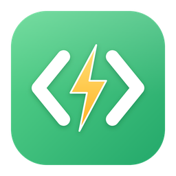
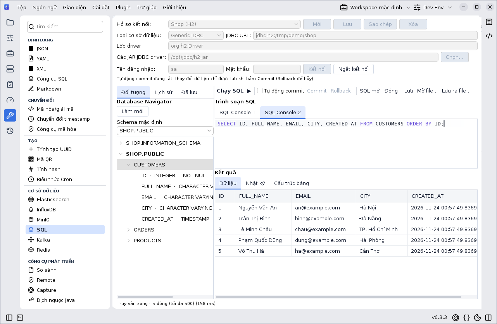

<div align="center">



# DevWorkbench

**An open-source Postman-style API client + JMeter-style load testing desktop app**<br>
*Local-first · Git workspaces · Headless CLI · Built-in MCP Server*

[](https://github.com/nvhuong/dev-workbench/releases)
[](https://github.com/nvhuong/dev-workbench/releases)
[](https://github.com/nvhuong/dev-workbench/stargazers)
[](https://openjdk.org/)
[](https://github.com/nvhuong/dev-workbench/releases)

[Tiếng Việt](README_vi.md) · [📦 Download](#-download-and-install) · [🤖 Install MCP](#-mcp-server) · [📖 Docs](#-documentation) · [💬 Discuss](https://github.com/nvhuong/dev-workbench/discussions)

</div>

---

## What is DevWorkbench?

DevWorkbench combines **Postman-style API debugging** and **JMeter-style performance testing** in one Java 21 desktop application. Collections, environments, and test data stay local by default, while Git workspaces support team collaboration. The same workspace can also run in CI through the headless CLI or be exposed to AI clients such as Codex, Claude Desktop, and Cursor through MCP.

| Core capability | What it provides |
|---|---|
| 🔌 API debugging | HTTP/HTTPS, SSE, WebSocket, auth, cookies, multiple body types, response inspection, and network logs |
| 🧩 Collections and scripts | Postman v2.1 / cURL import, environments, pre/post scripts, assertions, and request chaining |
| ⚡ Performance testing | Thread groups, timers, extractors, live metrics, PDF reports, and distributed master/worker runs |
| 🏢 Local and Git workspaces | Isolated collections, environments, and settings with user-controlled storage |
| 🧰 Plugins | SQL (Oracle, MySQL, PostgreSQL…), Redis, Kafka, MinIO, Remote (SSH terminal), Capture, Decompiler, Client Certificate |
| 🤖 MCP and headless CLI | Let AI run saved APIs and use the plugins; run collections, functional tests, and load plans in CI |

📖 [See the full feature list](docs/FEATURES.md)

## 🖼️ Preview

<table>
  <tr>
    <th width="50%">API debugging</th>
    <th width="50%">Performance testing</th>
  </tr>
  <tr>
    <td><a href="docs/collections.png"></a></td>
    <td><a href="docs/performance-trend.png"></a></td>
  </tr>
  <tr>
    <th width="50%">SQL plugin</th>
    <th width="50%">Scripts and snippets</th>
  </tr>
  <tr>
    <td><a href="docs/plugin-sql.png"></a></td>
    <td><a href="docs/script-snippets.png"></a></td>
  </tr>
</table>

📸 [View all screenshots](docs/SCREENSHOTS.md)

## 📦 Download and install

Download the latest release from **[GitHub Releases](https://github.com/nvhuong/dev-workbench/releases)**. Native installers and the Windows portable package include a runtime, so neither the desktop app nor MCP needs a separate Java installation. Only the cross-platform JAR requires Java 21+.

### Windows WinGet

```powershell
winget install --id Nvhuong.DevWorkbench --exact
```

Upgrade later with:

```powershell
winget upgrade --id Nvhuong.DevWorkbench --exact
```

### Choose a package

| Platform | File |
|---|---|
| macOS Apple Silicon | `DevWorkbench-{version}-macos-arm64.dmg` |
| macOS Intel | `DevWorkbench-{version}-macos-x86_64.dmg` |
| Windows installer / portable | `DevWorkbench-{version}-windows-x64.exe` / `-portable.zip` |
| Debian / Ubuntu x64 | `DevWorkbench-{version}-linux-amd64.deb` |
| Debian / Ubuntu ARM64 | `DevWorkbench-{version}-linux-arm64.deb`; use `-compat.deb` only for older incompatible `dpkg` versions |
| RHEL / Rocky / CentOS / Fedora | `DevWorkbench-{version}-1.x86_64.rpm` or `-1.aarch64.rpm` |
| Cross-platform JAR | `dev-workbench-{version}.jar`, requires Java 21+ |

Windows SmartScreen or macOS Gatekeeper may show a warning on first launch. Choose “Run anyway,” or right-click the macOS app and choose “Open.” The project does not currently use a commercial code-signing certificate, and all source code is available for review.

## 🤖 MCP Server

The MCP Server is included in every DevWorkbench release package, so there is **no separate MCP download or server to start manually**. The recommended native installers and Windows portable package bundle both `DevWorkbenchMCP` and a JRE, so users do not need to install Java.

### Recommended setup

1. Install a native package from [Releases](https://github.com/nvhuong/dev-workbench/releases), or extract the Windows portable ZIP.
2. Add a local STDIO MCP Server in Codex, Claude Desktop, or Cursor and use the platform launcher as `command`:

| Platform | `command` |
|---|---|
| macOS | `/Applications/DevWorkbench.app/Contents/MacOS/DevWorkbenchMCP` |
| Windows installer | `C:\Program Files\DevWorkbench\DevWorkbenchMCP.exe` |
| Windows portable | `DevWorkbenchMCP.exe` in the extracted directory, for example `D:\Tools\DevWorkbench\DevWorkbenchMCP.exe` |
| Linux DEB / RPM | `/opt/devworkbench/bin/DevWorkbenchMCP` |

The core macOS configuration is shown below; on another platform, replace only `command`:

```json
{
  "command": "/Applications/DevWorkbench.app/Contents/MacOS/DevWorkbenchMCP",
  "args": []
}
```

With Codex CLI:

```bash
codex mcp add dev-workbench -- /Applications/DevWorkbench.app/Contents/MacOS/DevWorkbenchMCP
```

3. Save the configuration, restart the MCP client, and open a new conversation. A safe first test is: `Use DevWorkbench MCP to list all workspaces. Do not run any request.`

Keep `args` empty for the default setup; no workspace path is required. The client starts one process per MCP connection and reuses it across tool calls—it does not restart DevWorkbench for every API call. Keep the entire Windows portable directory together; `DevWorkbenchMCP.exe` cannot be copied out by itself.

If you download only the cross-platform JAR, use this fallback and make sure Java 21+ is available:

```json
{
  "command": "java",
  "args": ["-jar", "/absolute/path/to/dev-workbench-{version}.jar", "mcp", "serve"]
}
```

By default, MCP loads workspaces registered in DevWorkbench. AI can call `list_workspaces`, then select a workspace and environment per tool call. The desktop app and MCP run as separate processes and can be used at the same time; MCP does not switch the desktop UI or change its current selection.

To authorize only one workspace, pass its absolute path in the native launcher's `args`; with the JAR fallback, append it after `"serve"`. The directory must contain `collections.json`; `environments.json` is optional.

JSON-based clients such as Claude Desktop and Cursor normally place the object above under `mcpServers.dev-workbench`. Codex can also use MCP Server settings or `config.toml`. See the [official Codex MCP documentation](https://developers.openai.com/codex/mcp/).

### What AI can do

AI can list workspaces, collections, environments, and saved requests, then use `run_request` or `run_collection` to select a workspace and environment for that call and execute HTTP APIs. Environment values are not exposed by listing tools. API response bodies are returned to the MCP client, so do not authorize workspaces containing sensitive business data to an untrusted client.

MCP can discover and execute only saved HTTP requests in authorized workspaces; it cannot construct an arbitrary URL on demand. MCP also runs functional tests (`run_functional`), lists request history, mock servers and load test plans, and queries Elasticsearch and InfluxDB. Installed plugins add tools for SQL, Redis, Kafka, MinIO, SSH servers and the decompiler. Everything connects through saved profiles, so passwords never pass through the AI client. Tools that change data or generate load (`run_performance`, `remote_exec`, `sql_execute`, `redis_write`, `kafka_send`, `elasticsearch_write`, `influxdb_write`, `minio_presigned_url`) are only available when `--allow-writes` is added to `args`. API response bodies are returned to the MCP client, and requests can cause real business side effects, so only trusted MCP clients should receive access to production workspaces.

📖 [Client setup for Claude, Codex, Gemini, Kilo Code, Cursor… (Vietnamese)](docs/MCP_CLIENTS_vi.md) · [Full MCP tools, architecture, and security guide (Vietnamese)](docs/MCP_SERVER_DESIGN_vi.md)

## 🚀 Quick start

The basic desktop workflow:

1. Create a local workspace or connect a Git workspace.
2. Create or import a collection and select an environment.
3. Enter the URL, parameters, and authentication, then send the request.
4. Add scripts, assertions, functional tests, or a load-test plan as needed.

Build and run from source:

```bash
git clone https://github.com/nvhuong/dev-workbench.git
cd dev-workbench
mvn -pl dev-workbench-app -am -DskipTests clean package
java -jar dev-workbench-app/target/dev-workbench-*.jar
```

📖 [Full build guide (Vietnamese)](docs/BUILD_vi.md)

## 🧪 Headless CLI

The same JAR can run a native DevWorkbench workspace without exporting collections or environments:

```bash
java -jar dev-workbench.jar collection run /srv/api-workspace -c "Basic HTTP Examples" -e "Dev Env"
java -jar dev-workbench.jar functional run /srv/api-workspace --bail --out target/result.json
```

- [Collection CLI guide (Vietnamese)](docs/COLLECTION_CLI_vi.md)
- [Functional CLI guide (Vietnamese)](docs/FUNCTIONAL_CLI_vi.md)
- [Distributed load testing guide (Vietnamese)](docs/PERFORMANCE_CLUSTER_LOAD_TEST_vi.md)

## 📚 Documentation

| Guide | Contents |
|---|---|
| [Feature reference](docs/FEATURES.md) | API debugging, scripts, Mock Server, performance testing, and workspaces |
| [MCP Server](docs/MCP_SERVER_DESIGN_vi.md) | Setup, tool inputs, workspace/environment routing, architecture, and security |
| [Collection CLI](docs/COLLECTION_CLI_vi.md) | Headless collection runs, variables, data, uploads, and CI exit codes |
| [Functional CLI](docs/FUNCTIONAL_CLI_vi.md) | Run functional tests from `functional_config.json` |
| [Plugin architecture](docs/PLUGINS_vi.md) | Plugin development and online/offline installation |
| [Script API](docs/SCRIPT_API_REFERENCE_vi.md) | Pre-request and test script reference |
| [Build guide](docs/BUILD_vi.md) | Source builds and native installers |
| [FAQ](docs/FQA.MD) | Installation and usage questions |

## 🛠️ Development and contributing

```bash
# Fast compile
mvn -q -pl dev-workbench-app -am -DskipTests compile

# Full build and tests
mvn clean package
```

Bug reports, ideas, documentation, and code contributions are welcome: [create an issue](https://github.com/nvhuong/dev-workbench/issues/new/choose) · [contribution guide](.github/CONTRIBUTING.md)

## 🙏 Credits and support

DevWorkbench builds on excellent open-source projects including [FlatLaf](https://github.com/JFormDesigner/FlatLaf), [RSyntaxTextArea](https://github.com/bobbylight/RSyntaxTextArea), and [OkHttp](https://github.com/square/okhttp).

If DevWorkbench helps you, consider giving it a [Star](https://github.com/nvhuong/dev-workbench), joining the [discussions](https://github.com/nvhuong/dev-workbench/discussions). Contact: phone 0964210295 · email [huong.nguyenvan.hd@gmail.com](mailto:huong.nguyenvan.hd@gmail.com).

<div align="center">

**Postman-style API debugging, JMeter-style performance testing**

Made with ❤️ by [nvhuong](https://github.com/nvhuong)

</div>
