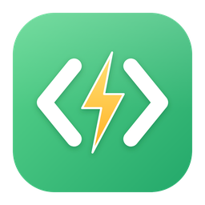
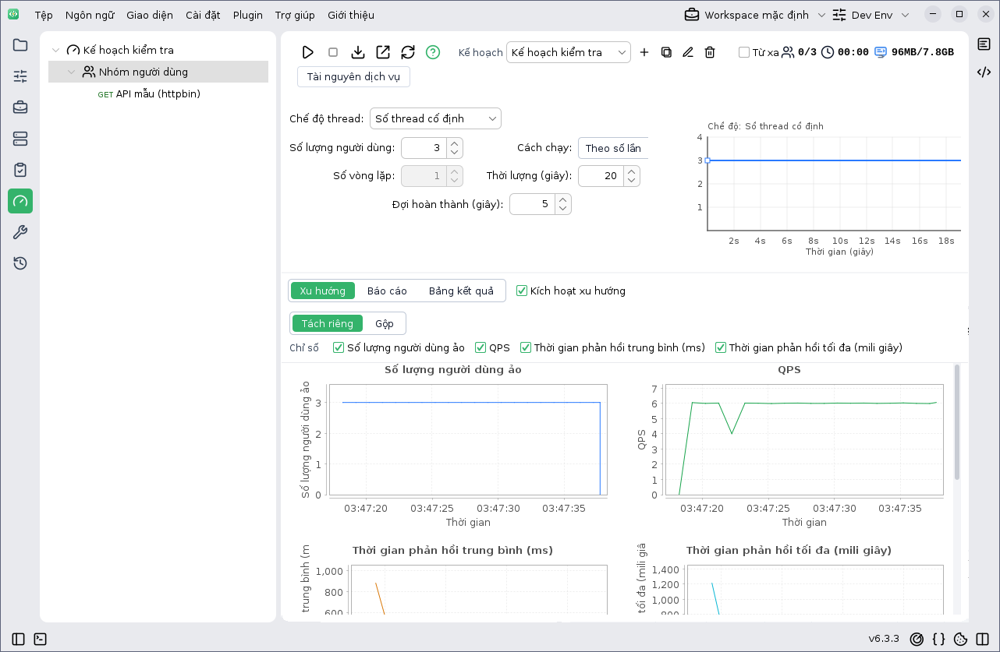
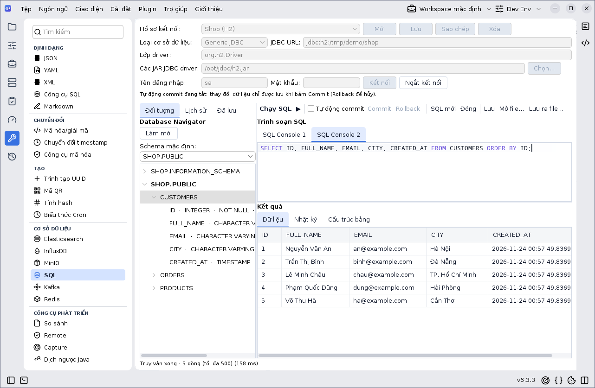

<div align="center">



# DevWorkbench

**Ứng dụng desktop mã nguồn mở: gọi thử API kiểu Postman + kiểm thử tải kiểu JMeter**<br>
*Dữ liệu lưu trên máy · Workspace Git · CLI không giao diện · MCP Server tích hợp sẵn*

[](https://github.com/nvhuong/dev-workbench/releases)
[](https://github.com/nvhuong/dev-workbench/releases)
[](https://github.com/nvhuong/dev-workbench/stargazers)
[](https://openjdk.org/)
[](https://github.com/nvhuong/dev-workbench/releases)

[English](README.md) · [📦 Tải về](#-tải-về-và-cài-đặt) · [🤖 Cài MCP](#-mcp-server) · [📖 Tài liệu](#-tài-liệu) · [💬 Thảo luận](https://github.com/nvhuong/dev-workbench/discussions)

</div>

---

## DevWorkbench là gì?

DevWorkbench gộp **gọi thử API** (kiểu Postman) và **kiểm thử hiệu năng** (kiểu JMeter) vào một ứng dụng desktop Java 21. Collection, môi trường và dữ liệu test mặc định nằm trên máy bạn; workspace Git giúp làm việc nhóm. Cùng một workspace có thể chạy trong CI bằng CLI, hoặc cho các AI client như Codex, Claude Desktop, Cursor dùng qua MCP.

| Năng lực chính | Nội dung |
|---|---|
| 🔌 Gọi thử API | HTTP/HTTPS, SSE, WebSocket, xác thực, cookie, nhiều kiểu body, xem response và network log |
| 🧩 Collection và script | Import Postman v2.1 / cURL, môi trường, script trước/sau request, assertion, nối chuỗi request |
| ⚡ Kiểm thử hiệu năng | Thread group, timer, extractor, chỉ số trực tiếp, báo cáo PDF, chạy phân tán master/worker |
| 🏢 Workspace cục bộ và Git | Collection, môi trường, cài đặt tách biệt theo workspace; bạn tự quyết nơi lưu |
| 🧰 Plugin | SQL (Oracle, MySQL, PostgreSQL…), Redis, Kafka, MinIO, Remote (terminal SSH), Capture, Decompiler, Client Certificate |
| 🤖 MCP và CLI | Cho AI chạy API đã lưu và dùng các plugin; chạy collection, functional test, kịch bản tải trong CI |

📖 [Danh sách tính năng đầy đủ](docs/FEATURES_vi.md)

## 🖼️ Giao diện

<table>
  <tr>
    <th width="50%">Gọi thử API</th>
    <th width="50%">Kiểm thử hiệu năng</th>
  </tr>
  <tr>
    <td><a href="docs/collections.png"></a></td>
    <td><a href="docs/performance-trend.png"></a></td>
  </tr>
  <tr>
    <th width="50%">Plugin SQL</th>
    <th width="50%">Script và snippet</th>
  </tr>
  <tr>
    <td><a href="docs/plugin-sql.png"></a></td>
    <td><a href="docs/script-snippets.png"></a></td>
  </tr>
</table>

📸 [Xem tất cả ảnh chụp màn hình](docs/SCREENSHOTS_vi.md)

## 📦 Tải về và cài đặt

Tải bản mới nhất ở **[GitHub Releases](https://github.com/nvhuong/dev-workbench/releases)**. Bộ cài và gói portable cho Windows đã kèm sẵn Java, nên cả app lẫn MCP đều không cần cài Java riêng. Chỉ file JAR đa nền tảng mới cần Java 21+.

### Windows (WinGet)

```powershell
winget install --id Nvhuong.DevWorkbench --exact
```

Nâng cấp:

```powershell
winget upgrade --id Nvhuong.DevWorkbench --exact
```

### Chọn gói cài đặt

| Nền tảng | File |
|---|---|
| macOS Apple Silicon | `DevWorkbench-{phiên bản}-macos-arm64.dmg` |
| macOS Intel | `DevWorkbench-{phiên bản}-macos-x86_64.dmg` |
| Windows (bộ cài / portable) | `DevWorkbench-{phiên bản}-windows-x64.exe` / `-portable.zip` |
| Debian / Ubuntu x64 | `DevWorkbench-{phiên bản}-linux-amd64.deb` |
| Debian / Ubuntu ARM64 | `DevWorkbench-{phiên bản}-linux-arm64.deb`; chỉ dùng `-compat.deb` khi `dpkg` quá cũ không cài được |
| RHEL / Rocky / CentOS / Fedora | `DevWorkbench-{phiên bản}-1.x86_64.rpm` hoặc `-1.aarch64.rpm` |
| JAR đa nền tảng | `dev-workbench-{phiên bản}.jar`, cần Java 21+ |

Lần chạy đầu, Windows SmartScreen hoặc macOS Gatekeeper có thể cảnh báo. Chọn “Vẫn chạy” (Run anyway), hoặc trên macOS nhấp chuột phải vào app rồi chọn “Mở”. Dự án chưa dùng chứng chỉ ký mã thương mại; toàn bộ mã nguồn đều công khai để kiểm tra.

## 🤖 MCP Server

MCP Server có sẵn trong mọi gói phát hành, **không cần tải hay khởi động server riêng**. Bộ cài và gói portable đã kèm `DevWorkbenchMCP` cùng Java.

### Cài đặt khuyên dùng

1. Cài DevWorkbench từ [Releases](https://github.com/nvhuong/dev-workbench/releases), hoặc giải nén gói portable cho Windows.
2. Trong Codex, Claude Desktop hoặc Cursor, thêm một MCP Server kiểu STDIO, với `command` là trình khởi chạy của nền tảng:

| Nền tảng | `command` |
|---|---|
| macOS | `/Applications/DevWorkbench.app/Contents/MacOS/DevWorkbenchMCP` |
| Windows (bộ cài) | `C:\Program Files\DevWorkbench\DevWorkbenchMCP.exe` |
| Windows (portable) | `DevWorkbenchMCP.exe` trong thư mục đã giải nén, ví dụ `D:\Tools\DevWorkbench\DevWorkbenchMCP.exe` |
| Linux DEB / RPM | `/opt/devworkbench/bin/DevWorkbenchMCP` |

Cấu hình cơ bản trên macOS; nền tảng khác chỉ cần đổi `command`:

```json
{
  "command": "/Applications/DevWorkbench.app/Contents/MacOS/DevWorkbenchMCP",
  "args": []
}
```

Với Codex CLI:

```bash
codex mcp add dev-workbench -- /Applications/DevWorkbench.app/Contents/MacOS/DevWorkbenchMCP
```

3. Lưu cấu hình, khởi động lại MCP client và mở cuộc trò chuyện mới. Câu thử an toàn đầu tiên: `Dùng DevWorkbench MCP liệt kê các workspace. Không chạy request nào.`

Mặc định để `args` trống, không cần đường dẫn workspace. Client khởi động một tiến trình cho mỗi kết nối MCP và dùng lại cho các lần gọi tool, không mở lại DevWorkbench mỗi lần. Với bản portable trên Windows, giữ nguyên cả thư mục; không chép riêng `DevWorkbenchMCP.exe` ra ngoài.

Nếu chỉ tải JAR đa nền tảng (cần Java 21+):

```json
{
  "command": "java",
  "args": ["-jar", "/duong/dan/tuyet/doi/dev-workbench-{phiên bản}.jar", "mcp", "serve"]
}
```

Mặc định MCP đọc các workspace đã đăng ký trong DevWorkbench. AI gọi `list_workspaces`, rồi chọn workspace và môi trường cho từng lần gọi tool. App desktop và MCP là hai tiến trình riêng, dùng cùng lúc được; MCP không đổi lựa chọn trên giao diện desktop.

Muốn chỉ cho phép một workspace: truyền đường dẫn tuyệt đối của nó vào `args` của trình khởi chạy; với JAR thì đặt sau `"serve"`. Thư mục phải có `collections.json`; `environments.json` không bắt buộc.

### AI làm được gì

- **API đã lưu:** liệt kê workspace, collection, môi trường, request; chạy `run_request` hoặc `run_collection`. Giá trị biến môi trường không bị lộ qua các tool liệt kê. MCP chỉ chạy được request đã lưu, không tự tạo URL tùy ý.
- **Functional test, lịch sử, mock server:** `run_functional`, `list_request_history`, `list_mock_servers`; kiểm thử hiệu năng: `list_performance_plans`.
- **Elasticsearch, InfluxDB và plugin:** đọc dữ liệu SQL, Redis, Kafka, MinIO, Elasticsearch, InfluxDB, decompile class, xem server SSH; dùng profile kết nối đã lưu (mật khẩu không đi qua AI).
- **Ghi dữ liệu hoặc tạo tải** (`run_performance`, `remote_exec`, `sql_execute`, `redis_write`, `kafka_send`, `elasticsearch_write`, `influxdb_write`, `minio_presigned_url`) chỉ bật khi thêm `--allow-writes` vào `args`.

Response của API và dữ liệu đọc được sẽ gửi về MCP client, và request có thể gây tác động thật. Chỉ cấp quyền workspace thật (production) cho MCP client đáng tin cậy.

📖 [Hướng dẫn MCP đầy đủ: cài đặt, tool, kiến trúc, bảo mật](docs/MCP_SERVER_DESIGN_vi.md)

## 🚀 Bắt đầu nhanh

Quy trình cơ bản trên desktop:

1. Tạo workspace cục bộ hoặc kết nối workspace Git.
2. Tạo hoặc import collection, chọn môi trường.
3. Nhập URL, tham số, xác thực rồi gửi request.
4. Thêm script, assertion, functional test hoặc kịch bản kiểm thử tải khi cần.

Build và chạy từ mã nguồn:

```bash
git clone https://github.com/nvhuong/dev-workbench.git
cd dev-workbench
mvn -pl dev-workbench-app -am -DskipTests clean package
java -jar dev-workbench-app/target/dev-workbench-*.jar
```

📖 [Hướng dẫn build đầy đủ](docs/BUILD_vi.md)

## 🧪 CLI không giao diện

Cùng một file JAR chạy trực tiếp workspace DevWorkbench, không cần export collection hay môi trường:

```bash
java -jar dev-workbench.jar collection run /srv/api-workspace -c "Basic HTTP Examples" -e "Dev Env"
java -jar dev-workbench.jar functional run /srv/api-workspace --bail --out target/result.json
```

- [Hướng dẫn Collection CLI](docs/COLLECTION_CLI_vi.md)
- [Hướng dẫn Functional CLI](docs/FUNCTIONAL_CLI_vi.md)
- [Hướng dẫn kiểm thử tải phân tán](docs/PERFORMANCE_CLUSTER_LOAD_TEST_vi.md)

## 📚 Tài liệu

| Tài liệu | Nội dung |
|---|---|
| [Tính năng](docs/FEATURES_vi.md) | Gọi thử API, script, Mock Server, kiểm thử hiệu năng, workspace |
| [MCP Server](docs/MCP_SERVER_DESIGN_vi.md) | Cài đặt, tham số tool, chọn workspace/môi trường, kiến trúc, bảo mật |
| [Collection CLI](docs/COLLECTION_CLI_vi.md) | Chạy collection không giao diện, biến, dữ liệu, upload, mã thoát cho CI |
| [Functional CLI](docs/FUNCTIONAL_CLI_vi.md) | Chạy functional test từ `functional_config.json` |
| [Plugin](docs/PLUGINS_vi.md) | Phát triển plugin, cài online/offline |
| [Script API](docs/SCRIPT_API_REFERENCE_vi.md) | Tham khảo script trước request và script test |
| [Build](docs/BUILD_vi.md) | Build từ mã nguồn và tạo bộ cài |
| [Câu hỏi thường gặp](docs/FQA.MD) | Cài đặt và sử dụng |

## 🛠️ Phát triển và đóng góp

```bash
# Biên dịch nhanh
mvn -q -pl dev-workbench-app -am -DskipTests compile

# Build đầy đủ kèm test
mvn clean package
```

Mọi báo lỗi, ý tưởng, tài liệu và mã nguồn đều được hoan nghênh: [tạo issue](https://github.com/nvhuong/dev-workbench/issues/new/choose) · [hướng dẫn đóng góp](.github/CONTRIBUTING.md)

## 🙏 Cảm ơn và ủng hộ

DevWorkbench dựa trên các dự án mã nguồn mở tuyệt vời như [FlatLaf](https://github.com/JFormDesigner/FlatLaf), [RSyntaxTextArea](https://github.com/bobbylight/RSyntaxTextArea) và [OkHttp](https://github.com/square/okhttp).

Nếu DevWorkbench có ích cho bạn, hãy tặng dự án một [Star](https://github.com/nvhuong/dev-workbench) hoặc tham gia [thảo luận](https://github.com/nvhuong/dev-workbench/discussions). Liên hệ: điện thoại 0964210295 · email [huong.nguyenvan.hd@gmail.com](mailto:huong.nguyenvan.hd@gmail.com).

<div align="center">

**Gọi thử API tiện như Postman, kiểm thử hiệu năng đầy đủ như JMeter**

Made with ❤️ by [nvhuong](https://github.com/nvhuong)

</div>
