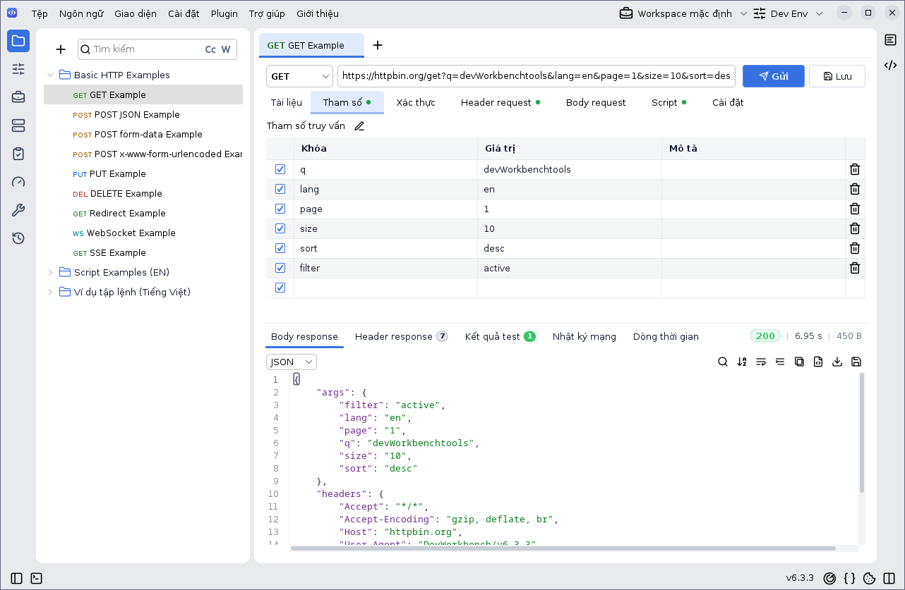
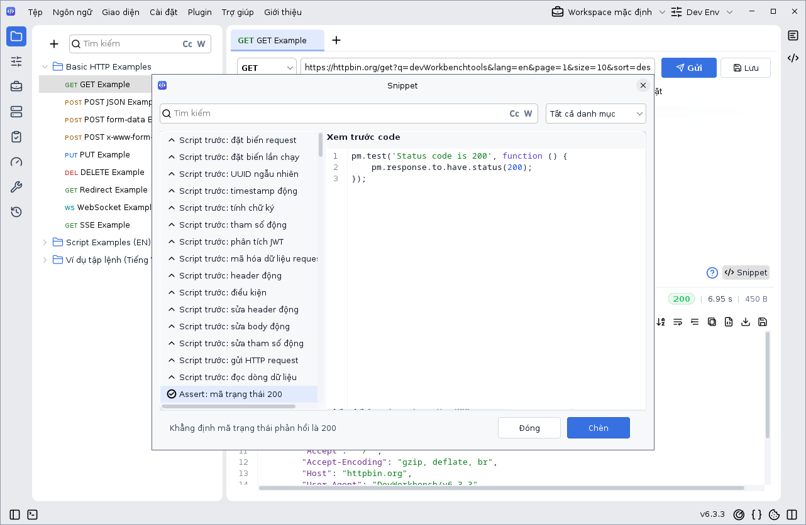

<div align="center">


# DevWorkbench

**Nguồn mở DevWorkbench Gỡ lỗi giao diện kiểu + JMeter Công cụ máy tính để bàn kiểm tra hiệu suất phong cách**<br>
*Ưu tiên địa phương · Git khu vực làm việc · Không đầu CLI · Tích hợp sẵn MCP Server*

[](https://github.com/nvhuong/dev-workbench/blob/master/LICENSE)
[](https://github.com/nvhuong/dev-workbench/releases)
[](https://github.com/nvhuong/dev-workbench/releases)
[](https://github.com/nvhuong/dev-workbench/stargazers)
[](https://openjdk.org/)
[](https://github.com/nvhuong/dev-workbench/releases)

[English](README.md) · [📦 tải về](#-Tải xuống và cài đặt) · [🤖 Cài đặt MCP](#-mcp-server) · [📖 Tài liệu](#-Tài liệu) · [💬 Bảng thảo luận](https://github.com/nvhuong/dev-workbench/discussions) · Wechat: .`nvhuong`

</div>

---

## DevWorkbench Nó là gì vậy?

DevWorkbench Bó **DevWorkbench gỡ lỗi giao diện phong cách**và **JMeter thử nghiệm hiệu suất phong cách**Đặt trong cùng một Java 21 Ứng dụng máy tính để bàn. Dữ liệu thu thập, môi trường và thử nghiệm được lưu cục bộ theo mặc định và có sẵn Git Cộng tác không gian làm việc; cùng một không gian làm việc vẫn có thể đi qua CLI Vào CI Chạy vào hoặc vượt qua MCP Đưa nó cho Codex、Claude Desktop、Cursor Đợi đã AI Cuộc gọi của khách hàng.

| năng lực cốt lõi | Mô tả |
|---|---|
| 🔌 API gỡ lỗi | HTTP/HTTPS、SSE、WebSocket、Chứng nhận,Cookie、Khác nhau Body、Xem phản hồi và nhật ký web |
| 🧩 Bộ sưu tập và kịch bản | DevWorkbench v2.1 / cURL Nhập khẩu, biến môi trường, tập lệnh trước và sau, xác nhận, liên kết yêu cầu |
| ⚡ Kiểm tra hiệu suất | Nhóm chủ đề, bộ tính giờ, bộ trích xuất, số liệu thời gian thực,PDF Báo cáo và master/worker Thực thi phân tán |
| 🏢 Địa phương so với Git khu vực làm việc | Mỗi không gian làm việc chứa các bộ sưu tập, môi trường và cài đặt độc lập, để lại dữ liệu dưới sự kiểm soát của người dùng |
| 🤖 MCP Không có đầu CLI | AI Nhớ lại đã lưu API；CI Chạy các bộ sưu tập, kiểm tra chức năng và kế hoạch kiểm tra căng thẳng |

📖 [Xem danh sách tính năng đầy đủ](docs/FEATURES_zh.md)

## 🖼️ Xem trước giao diện

<table>
  <tr>
    <th width="50%">DevWorkbench Gỡ lỗi giao diện kiểu</th>
    <th width="50%">JMeter Kiểm tra hiệu suất phong cách</th>
  </tr>
  <tr>
    <td><a href="docs/collections.png"></a></td>
    <td><a href="docs/performance-trend.png"></a></td>
  </tr>
  <tr>
    <th width="50%">Tập lệnh, xác nhận và đoạn mã</th>
    <th width="50%">Git Cộng tác không gian làm việc</th>
  </tr>
  <tr>
    <td><a href="docs/script-snippets.png"></a></td>
    <td><a href="docs/workspaces-gitcommit.png"></a></td>
  </tr>
</table>

📸 [Kiểm tra bộ ảnh chụp màn hình đầy đủ](docs/SCREENSHOTS_zh.md)

## 📦 Tải xuống và cài đặt

Từ **[GitHub Releases](https://github.com/nvhuong/dev-workbench/releases)** Tải xuống phiên bản mới nhất; người dùng trong nước cũng có thể sử dụng nó **[Gitee Releases](https://gitee.com/nvhuong/dev-workbench/releases)**。Gói cài đặt gốc và Windows Phiên bản di động đã bao gồm thời gian chạy, máy tính để bàn và MCP Không cần phải cài đặt bất cứ điều gì khác Java；Chỉ đa nền tảng JAR Cần thiết Java 21+。

### Windows WinGet

```powershell
winget install --id Nvhuong.DevWorkbench --exact
```

Nâng cấp:

```powershell
winget upgrade --id Nvhuong.DevWorkbench --exact
```

### Cách chọn gói cài đặt

| nền tảng | tập tin |
|---|---|
| macOS Apple Silicon | `DevWorkbench-{Số phiên bản}-macos-arm64.dmg` |
| macOS Intel | `DevWorkbench-{Số phiên bản}-macos-x86_64.dmg` |
| Windows Phiên bản cài đặt / Phiên bản di động | `DevWorkbench-{Số phiên bản}-windows-x64.exe` / `-portable.zip` |
| Debian / Ubuntu x64 | `DevWorkbench-{Số phiên bản}-linux-amd64.deb` |
| Debian / Ubuntu ARM64 | `DevWorkbench-{Số phiên bản}-linux-arm64.deb`；Phiên bản cũ `dpkg` Được sử dụng khi không tương thích `-compat.deb` |
| RHEL / Rocky / CentOS / Fedora | `DevWorkbench-{Số phiên bản}-1.x86_64.rpm` hoặc `-1.aarch64.rpm` |
| Đa nền tảng JAR | `dev-workbench-{Số phiên bản}.jar`，Cần thiết Java 21+ |

Nếu gặp phải khi bắt đầu lần đầu tiên Windows SmartScreen hoặc macOS Gatekeeper Nhắc nhở, vui lòng chọn“Vẫn phải chạy”Hoặc nhấn chuột phải để áp dụng và chọn“Mở”。Dự án không mua chứng chỉ ký mã thương mại và tất cả mã nguồn đều có thể được xem xét công khai.

## 🤖 MCP Server

DevWorkbench của MCP Bao gồm trong tất cả các gói phát hành.**Không cần phải tải xuống riêng biệt MCP，Không cần phải khởi động dịch vụ theo cách thủ công**。Nên sử dụng gói cài đặt gốc hoặc Windows Phiên bản di động: đã được bao gồm `DevWorkbenchMCP` và JRE，Người dùng không cần phải cài đặt riêng Java。

### Phương pháp cài đặt được đề xuất

1. Từ [Releases](https://github.com/nvhuong/dev-workbench/releases) Cài đặt gói gốc hoặc giải nén nó Windows Phiên bản di động.
2. Vào Codex、Claude Desktop hoặc Cursor Thêm địa phương STDIO MCP Server，`command` Sử dụng trình khởi chạy tương ứng: .

| nền tảng | `command` |
|---|---|
| macOS | `/Applications/DevWorkbench.app/Contents/MacOS/DevWorkbenchMCP` |
| Windows Phiên bản cài đặt | `C:\Program Files\DevWorkbench\DevWorkbenchMCP.exe` |
| Windows Phiên bản di động | Giải nén thư mục `DevWorkbenchMCP.exe`，Ví dụ `D:\Tools\DevWorkbench\DevWorkbenchMCP.exe` |
| Linux DEB / RPM | `/opt/devworkbench/bin/DevWorkbenchMCP` |

macOS Cấu hình cốt lõi như sau, các nền tảng khác chỉ cần thay thế `command`：

```json
{
  "command": "/Applications/DevWorkbench.app/Contents/MacOS/DevWorkbenchMCP",
  "args": []
}
```

Codex CLI Có thể thực hiện trực tiếp:

```bash
codex mcp add dev-workbench -- /Applications/DevWorkbench.app/Contents/MacOS/DevWorkbenchMCP
```

3. Lưu và sau đó khởi động lại MCP Client và tạo một cuộc trò chuyện mới, bạn có thể sử dụng câu này để xác minh:`Hãy sử dụng DevWorkbench MCP Liệt kê tất cả các không gian làm việc mà không thực hiện bất kỳ giao diện nào.`

Mặc định `args` Nếu nó trống thì không cần cấu hình thư mục không gian làm việc. Khách hàng một lần MCP Kết nối bắt đầu một quá trình và chạy nhiều lần Tool Tái sử dụng nó giữa các cuộc gọi; không phải một cuộc gọi API Chỉ cần khởi động lại một lần.Windows Phiên bản di động phải giữ lại toàn bộ thư mục đã giải nén chứ không chỉ sao chép `DevWorkbenchMCP.exe`。

Nếu bạn chỉ tải xuống đa nền tảng JAR，Sau đó sử dụng cấu hình thay thế bên dưới và đảm bảo Java 21+ Có sẵn:

```json
{
  "command": "java",
  "args": ["-jar", "/absolute/path/to/dev-workbench-{version}.jar", "mcp", "serve"]
}
```

MCP Đọc mặc định DevWorkbench Đã đăng ký không gian làm việc;AI Có thể vượt qua `list_workspaces` Lấy `workspaceId`，Sau đó chọn không gian làm việc và môi trường cho mỗi cuộc gọi. Máy tính để bàn và  MCP Đây là một quá trình độc lập và có thể chạy cùng lúc;MCP Nó sẽ không chuyển trang màn hình nền hoặc sửa đổi lựa chọn hiện tại trên màn hình nền.

Để chỉ ủy quyền cho một không gian làm việc, trình khởi chạy gốc có sẵn ở định dạng  `args` Vượt qua đường dẫn tuyệt đối của không gian làm việc;JAR Phương pháp là `"serve"` được bổ sung sau. Thư mục này nên chứa `collections.json`，`environments.json` Không bắt buộc.

Claude Desktop、Cursor Đợi đã JSON Việc cấu hình máy khách thường đặt các đối tượng trên vào `mcpServers.dev-workbench` Xuống.Codex Cũng có sẵn MCP Server Đặt hoặc `config.toml`。Tham khảo [Codex MCP Tài liệu chính thức](https://developers.openai.com/codex/mcp/)。

### AI Có thể làm được gì

AI Không gian làm việc, bộ sưu tập, môi trường và yêu cầu đã lưu có thể được liệt kê và thông qua `run_request` hoặc `run_collection` Chọn không gian làm việc và môi trường cho cuộc gọi này và thực hiện nó HTTP API。Giá trị biến môi trường sẽ không được liệt kê; phần thân phản hồi giao diện sẽ được trả về MCP khách hàng, do đó, không ủy quyền các không gian làm việc chứa dữ liệu kinh doanh nhạy cảm cho các khách hàng không đáng tin cậy.

MCP Chỉ những thứ được lưu trong không gian làm việc được ủy quyền mới có thể được phát hiện và thực thi HTTP Yêu cầu không thể được ngẫu hứng URL。Phần thân phản hồi giao diện sẽ được trả về MCP Với khách hàng, việc thực hiện các yêu cầu cũng có thể có những tác dụng phụ thực sự đối với hoạt động kinh doanh, vì vậy, không gian làm việc sản xuất chỉ nên được ủy quyền cho những khách hàng đáng tin cậy.

📖 [MCP Hoàn tất cài đặt, công cụ, kiến ​​trúc và ranh giới bảo mật](docs/MCP_SERVER_DESIGN_zh.md)

## 🚀 Bắt đầu nhanh chóng

Quy trình cơ bản trên máy tính để bàn:

1. Tạo một không gian làm việc cục bộ hoặc kết nối với một không gian làm việc Git khu vực làm việc.
2. Tạo hoặc nhập bộ sưu tập, chọn môi trường.
3. Nhập URL、thông số và thông tin xác thực, sau đó gửi yêu cầu.
4. Thêm tập lệnh, xác nhận, kiểm tra chức năng hoặc kế hoạch kiểm tra hiệu suất nếu cần.

Chạy từ nguồn: .

```bash
git clone https://github.com/nvhuong/dev-workbench.git
cd dev-workbench
mvn -pl dev-workbench-app -am -DskipTests clean package
java -jar dev-workbench-app/target/dev-workbench-*.jar
```

📖 [Hướng dẫn xây dựng hoàn chỉnh](docs/BUILD_zh.md)

## 🧪 Không đầu CLI

Cùng một JAR Có thể chạy trực tiếp DevWorkbench Không gian làm việc gốc, không cần xuất bộ sưu tập hoặc môi trường:

```bash
java -jar dev-workbench.jar collection run /srv/api-workspace -c "Basic HTTP Examples" -e "Dev Env"
java -jar dev-workbench.jar functional run /srv/api-workspace --bail --out target/result.json
```

- [Collection CLI Hướng dẫn đầy đủ](docs/COLLECTION_CLI_zh.md)
- [Functional CLI Hướng dẫn đầy đủ](docs/FUNCTIONAL_CLI_zh.md)
- [Hướng dẫn kiểm tra căng thẳng cụm](docs/PERFORMANCE_CLUSTER_LOAD_TEST_zh.md)

## 📚 Tài liệu

| Tài liệu | nội dung |
|---|---|
| [Mô tả chi tiết các chức năng](docs/FEATURES_zh.md) | API Gỡ lỗi, viết kịch bản,Mock、Kiểm tra hiệu suất và khả năng làm việc |
| [MCP Server](docs/MCP_SERVER_DESIGN_zh.md) | Cài đặt,Tool Các thông số, không gian làm việc/Lựa chọn môi trường, kiến trúc và ranh giới an ninh |
| [Collection CLI](docs/COLLECTION_CLI_zh.md) | Bộ sưu tập các lần chạy không đầu, các biến, dữ liệu lặp, tải lên và CI Mã thoát |
| [Functional CLI](docs/FUNCTIONAL_CLI_zh.md) | Nhấn `functional_config.json` Thực hiện kiểm tra chức năng |
| [Kiến trúc plug-in](docs/PLUGINS_zh.md) | Phát triển plug-in, cài đặt trực tuyến và ngoại tuyến |
| [kịch bản API](docs/SCRIPT_API_REFERENCE_zh.md) | Yêu cầu trước và tham khảo tập lệnh thử nghiệm |
| [Hướng dẫn xây dựng](docs/BUILD_zh.md) | Xây dựng mã nguồn và gói cài đặt gốc |
| [Câu hỏi thường gặp](docs/FQA.MD) | Vấn đề cài đặt và sử dụng |

## 🛠️ Phát triển và Đóng góp

```bash
# Biên soạn nhanh
mvn -q -pl dev-workbench-app -am -DskipTests compile

# Được xây dựng và thử nghiệm đầy đủ
mvn clean package
```

Đệ trình đều được chào đón Bug、Gợi ý, tài liệu và mã: .[Tạo Issue](https://github.com/nvhuong/dev-workbench/issues/new/choose) · [Nguyên tắc đóng góp](.github/CONTRIBUTING.md)

## 🙏 Cảm ơn và hỗ trợ

DevWorkbench đã sử dụng [FlatLaf](https://github.com/JFormDesigner/FlatLaf)、[RSyntaxTextArea](https://github.com/bobbylight/RSyntaxTextArea)、[OkHttp](https://github.com/square/okhttp) và các dự án nguồn mở xuất sắc khác.

Nếu dự án hữu ích cho bạn, xin chào mừng bạn [Star](https://github.com/nvhuong/dev-workbench)、[Tham gia vào các cuộc thảo luận](https://github.com/nvhuong/dev-workbench/discussions) Hoặc thêm WeChat `nvhuong` giao tiếp.

<div align="center">

**Hãy để giao diện gỡ lỗi như thế nào DevWorkbench Cũng dễ sử dụng như kiểm tra hiệu suất JMeter Cũng như đầy đủ**

Made with ❤️ by [nvhuong](https://github.com/nvhuong)

</div>
