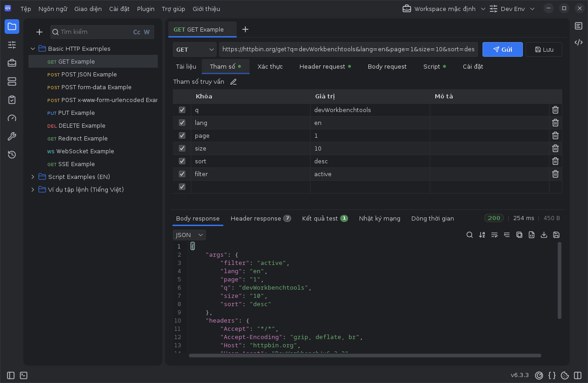
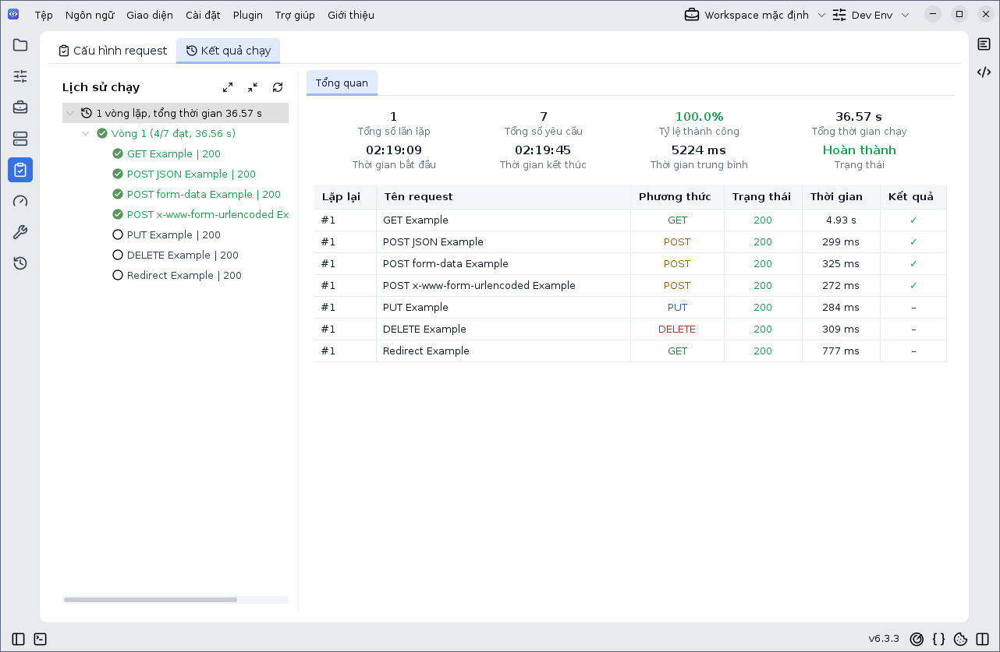
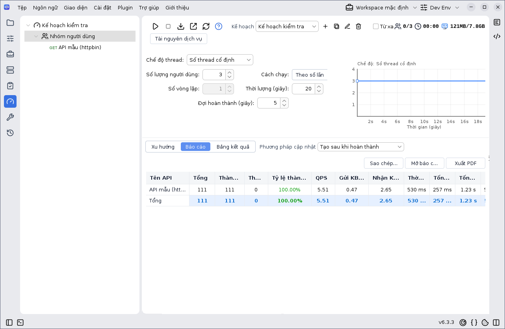

# 🖼️ Hiển thị ảnh chụp màn hình

## Biểu tượng ứng dụng & Giao diện chào mừng

|                                 biểu tượng                                  |                                  Giao diện chào mừng                                   |
|:---------------------------------------------------------------------:|:-------------------------------------------------------------------------:|
|                                                    |                                                |

## Giao diện chính

### Quản lý bộ sưu tập giao diện
|                                 Bộ sưu tập giao diện                                  |                                  Bộ sưu tập nhập khẩu                                   |
|:------------------------------------------------------------------------:|:--------------------------------------------------------------------------:|
|                                      |                          |

### Chế độ tối
|                                 Giao diện bộ sưu tập tối                                  |                                  Biểu đồ xu hướng hiệu suất tối                                   |
|:----------------------------------------------------------------------------:|:-------------------------------------------------------------------------------:|
|                        |                    |

## các biến môi trường & Kiểm tra chức năng

### Kiểm tra chức năng
|                                 Kiểm tra chức năng                                  |                                  Kiểm tra chức năng 1                                   |                                  Kiểm tra chức năng 2                                   |
|:------------------------------------------------------------------------:|:----------------------------------------------------------------------------:|:----------------------------------------------------------------------------:|
|                                          |                                    |                                    |

|                                 Kết quả kiểm tra chức năng                                  |
|:----------------------------------------------------------------------------:|
|                                |

## Kiểm tra hiệu suất

### Giao diện chính
|                                 Kiểm tra hiệu suất                                  |
|:------------------------------------------------------------------------:|
|                                      |

### Báo cáo & phân tích
|                                 Báo cáo hiệu suất                                  |                                  Biểu đồ xu hướng hiệu suất                                   |
|:------------------------------------------------------------------------:|:----------------------------------------------------------------------------:|
|                          |                            |

### Chế độ nhóm chủ đề
|                                 Chủ đề cố định                                  |                                  Chủ đề tăng dần                                   |
|:------------------------------------------------------------------------:|:--------------------------------------------------------------------------:|
|  |  |

|                                 Chủ đề có gai                                  |                                  Sợi thang                                   |
|:------------------------------------------------------------------------:|:--------------------------------------------------------------------------:|
|  |  |

## Hỗ trợ viết kịch bản

### Kịch bản thử nghiệm
|                                  Kịch bản thử nghiệm                                   |
|:--------------------------------------------------------------------------:|
|                                        |

### Đoạn mã
|                                 Thư viện đoạn mã                                  |
|:--------------------------------------------------------------------------:|
|                              |

## Git tích hợp

### Git nộp
|                                 Git Gửi không gian làm việc                                  |
|:------------------------------------------------------------------------------:|
|                      |
