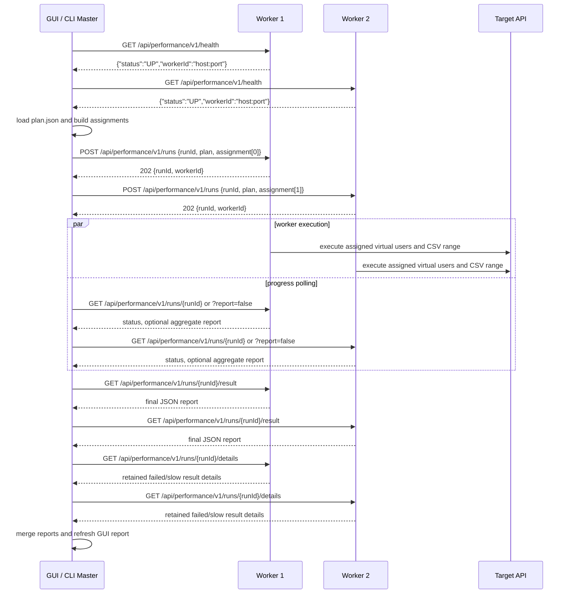

# Thiết kế mô-đun kiểm tra căng thẳng hiệu suất

Tài liệu này giải thích `com.nvhuong.devworkbench.panel.performance` Hiểu ranh giới thiết kế hiện tại của chức năng kiểm tra áp suất, tập trung vào phạm vi bao phủ UI、Mô hình thực thi, mô hình nhóm luồng, lấy mẫu số liệu và làm mới kết quả.

## mục tiêu thiết kế

- `PerformancePanel` Chỉ chịu trách nhiệm lắp ráp Swing Chế độ xem, sự kiện ràng buộc và vòng đời phối hợp không mang theo chi tiết thực hiện kiểm tra căng thẳng.
- Thực hiện kiểm tra căng thẳng và UI Làm mới việc tách rời: Yêu cầu thực thi trong nhóm luồng worker Hoàn thành vào , ảnh chụp nhanh thống kê được tạo trong chuỗi nền chuyên dụng.Swing Thành phần này chỉ có trong EDT đổi mới.
- Quản lý tập trung các mô hình luồng: Tất cả các luồng nền kiểm tra mức độ căng thẳng về hiệu năng đều được đặt tên và thiết lập thông qua một nhà máy thống nhất daemon，Thuận tiện cho việc gỡ lỗi, tắt máy và khắc phục sự cố nhật ký.
- Lấy mẫu gia tăng dữ liệu chỉ báo: tổng báo cáo sử dụng số liệu thống kê tích lũy và biểu đồ xu hướng sử dụng số liệu thống kê của cửa sổ lấy mẫu.WebSocket/SSE Các kết nối dài sử dụng tính năng đếm thời gian thực để bổ sung cho trường hợp mẫu không được hoàn thành trong cửa sổ.
- Hiển thị kết quả đồng thời cao vẫn bị giới hạn: bảng kết quả được chuyển qua tổng hàng đợi Swing Timer Làm mới theo đợt để tránh kích hoạt trực tiếp từng yêu cầu EDT đổi mới.
- GUI、headless CLI và worker Sử dụng cùng trạng thái chạy `plan.json`。`collections.json`、`environments.json`、`performance_config.json` Nó là một tập tin không gian làm việc chỉnh sửa;`plan.json` Đó là một ảnh chụp nhanh ngữ nghĩa có thể thực thi được, bao gồm môi trường, biến toàn cục, cài đặt thực thi, kế hoạch thực thi và các phần bên ngoài asset Trích dẫn.

## Kết luận thiết kế đa phương án

hiện tại GUI Hỗ trợ chỉnh sửa“Một không gian làm việc lưu trữ nhiều kế hoạch kiểm tra sức chịu đựng nhưng mỗi lần chỉ có một kế hoạch active plan”。hàng đầu plan Bộ chọn có trách nhiệm tạo, sao chép, đổi tên, xóa và chuyển đổi; khu vực chỉnh sửa.Start、Xuất khẩu `plan.json`、CLI/master/worker Phân phối chỉ là hiện tại active plan。

Nút gốc bên trái“Kế hoạch kiểm tra”Bạn vẫn có thể định cấu hình nhiều bên dưới Thread Group，Họ thuộc về cùng một active plan；Đã bật kiểm tra Thread Group sẽ ở cùng một thời điểm Start cùng nhau thực hiện.

Chưa GUI Tạo nhiều lớp trên cùng plan Thực hiện đồng thời vì nhiều lý do plan Phối hợp giới thiệu ngữ nghĩa thời gian chạy mới: khác nhau plan Nhóm chủ đề,CSV Phân đoạn, báo cáo tóm tắt và kết quả chi tiết.Stop All、worker assignment Tất cả đều cần phải được nhấn plan Cách ly kích thước. Nếu nhiều được phép trực tiếp plan Chạy cùng lúc sẽ cho một lần report Nhiều mục tiêu thử nghiệm được trộn lẫn vào cùng một lúc, việc định vị và so sánh tiếp theo không rõ ràng.

Ranh giới hiện tại: .

1. Trạng thái chỉnh sửa được lưu trữ dưới dạng `plans[] + activePlanId`，Mỗi plan Lưu của riêng bạn tree、efficientMode、trendEnabled、reportRealtimeEnabled、remote worker cấu hình.
2. Nhấp chuột duy nhất Start Chỉ thực hiện cái hiện được chọn active plan。Thực hiện nhiều đợt plan Nên được coi là độc lập“Dàn nhạc hàng loạt/bộ”Khả năng, chiến lược nối tiếp hoặc song song yêu cầu cấu hình rõ ràng.
3. `plan.json` Vẫn đại diện cho một tệp thực thi plan，Đừng thay đổi nó để bao gồm nhiều hơn một cùng một lúc plan。CLI/master/worker Tiếp tục với một plan Nó là đơn vị thực thi nhỏ nhất; lớp điều phối hàng loạt chịu trách nhiệm nhấn nhiều `plan.json` Đã bắt đầu nhiều lần run。
4. Các báo cáo, xu hướng và chi tiết kết quả đều được trình bày dưới dạng  runId sự cách ly. Nếu bạn muốn sắp xếp hàng loạt trong tương lai, hãy thêm nó ở cấp độ gói planId và ngang qua plan Tóm tắt so sánh, không phải là một bài kiểm tra căng thẳng duy nhất report Hỗn hợp vừa.

## Các thành phần chính

### UI Sự sắp xếp

- `PerformancePanel`：Lối vào mô-đun, cây tạo, bảng thuộc tính, trang kết quả, công cụ thực thi, điều phối viên thống kê và bộ đếm thời gian.
- `PerformancePanelViewFactory`：Tạo tập trung Swing các thành phần, hạ xuống `PerformancePanel` của UI Xây dựng khối lượng mã.
- hàng đầu plan Bộ chọn cung cấp khả năng quản lý nhiều gói trong chế độ chỉnh sửa. chuyển đổi plan Cái trước sẽ là hiện tại UI tree và cài đặt thực thi được ghi lại vào ảnh chụp nhanh bộ nhớ trước khi tải mục tiêu plan，Tránh các nhóm chủ đề có kế hoạch khác nhau.CSV và worker Các cấu hình làm ô nhiễm lẫn nhau.
- Hỗ trợ thanh công cụ hàng đầu `Remote` chế độ và worker Cấu hình danh sách. Sau khi mở GUI của Start/Stop Không còn thực thi nguyên bản nữa mà nhấn JMeter Remote Start/Stop All Ngữ nghĩa kiểm soát tất cả các cấu hình worker；Số lượng người dùng ảo hàng đầu, chuyển đổi xu hướng và phương pháp làm mới báo cáo duy trì cùng một bộ ngữ nghĩa như thực thi gốc.
- `PerformanceTreeSupport` / `PerformanceTreeInteractionSupport`：Quản lý cấu trúc nút cây, menu chuột phải, chọn nút và đồng bộ hóa cấu trúc yêu cầu.
- `PerformancePropertyPanelSupport`：Lưu dữ liệu bảng thuộc tính hiện tại và chặn các nhóm luồng, xác nhận và bộ hẹn giờ.SSE、WebSocket Cấu hình các chi tiết của bảng điều khiển.
- `PerformanceRunControlSupport`：Xử lý bắt đầu, dừng, trạng thái nút, cuối cùng flush và thông báo hoàn thành.
- `PerformanceRemoteRunControlSupport`：GUI Bộ điều khiển thực thi từ xa chịu trách nhiệm tạo trạng thái đang chạy `plan`、Đối với worker Phân phối assignment、Tình trạng bỏ phiếu,Stop All và xử lý master Báo cáo tổng hợp được viết lại GUI Trang báo cáo.

### Mô hình thực hiện

- `PerformanceTestPlanCompiler`：Sẽ thực hiện ảnh chụp nhanh từ Swing `DefaultMutableTreeNode` Được tổng hợp thành các kế hoạch thực hiện hiệu suất bất biến. Được quy hoạch bởi `PerformanceTestPlan`、`PerformanceThreadGroupPlan`、`PerformanceLoopController`、`PerformanceTimerElement`、`PerformanceRequestSampler`、Nó bao gồm các phần tử xác nhận và các phần tử pha giao thức.
- `com.nvhuong.devworkbench.panel.performance.plan`：Chỉ lưu các bất biến cần thiết để thực thi plan dữ liệu. Ngoại trừ trình biên dịch chịu trách nhiệm đọc Swing tree ngoài,plan Các phần tử không còn cung cấp khả năng tái thiết ngược Swing tree của API。
- `dev-workbench-performance-core` của `PerformanceRunPlan`：Trạng thái đang chạy envelope，cứu `environment`、`globals`、`settings`、`testPlan`、`assets`。Nó không lưu Swing tree hoặc `HttpRequestItem`，Thay vào đó, hãy lưu khoảng thời gian GUI/CLI/worker Ảnh chụp nhanh yêu cầu tiêu thụ;`settings` Chỉ cần đặt ngữ nghĩa thực thi, ví dụ efficientMode và HTTP runtime Các tham số đồng thời, chuyển đổi xu hướng, làm mới báo cáo theo thời gian thực, v.v GUI Hiển thị trạng thái.
- `PerformanceRunPlanFactory`：GUI Xuất khẩu `plan.json` Cấu hình stress test hiện tại, môi trường hoạt động, các biến toàn cục và asset Tham chiếu được cố định vào một kế hoạch đang chạy.
- `com.nvhuong.devworkbench.performance.runtime.PerformanceRunPlanExecutor`：headless CLI và worker Đã chia sẻ app Bộ chuyển đổi chạy bên, đã tải `plan.json`，Sẽ core plan Đã vượt qua sau khi biên soạn `PerformanceCorePlanAdapter.toExecutablePlan(...)` Chuyển đổi sang app Chuỗi thực thi hiện tại có thể được sử dụng plan，và tái sử dụng `PerformanceExecutionEngine` thực hiện.CLI Gói này chỉ chịu trách nhiệm phân tích tham số và đưa ra kết quả.
- `PerformanceExecutionEngine`：Mặt tiền thực thi, chịu trách nhiệm chạy vòng đời, chỉ báo thời gian thực, tài nguyên hủy mạng và cây đến plan chuyển đổi lối vào. Nó không còn đi qua trực tiếp nữa Swing tree。
- `PerformanceThreadGroupRunner`：Thực thi nhóm luồng được kích hoạt và dựa trên FIXED、RAMP_UP、SPIKE、STAIRS Lên lịch cho người dùng ảo worker。
- `PerformancePlanExecutor`：Các mô hình bộ điều khiển trong nhóm luồng thực thi được xử lý tuần tự Loop、Timer và Request Sampler。
- `PerformanceSamplerExecutor`：Bó request sampler Đưa nó cho `PerformanceRequestExecutor`，và đã vượt qua `PerformanceResultRecorder` Ghi lại kết quả. Lớp thực thi tiêu thụ trực tiếp plan model，request Cấp độ không còn được giữ lại tree-based Mục thực thi.
- `PerformanceIterationContextFactory`：Được tạo cho mỗi lần lặp của người dùng ảo `ExecutionVariableContext`，Đặt số lần lặp và nhấn hiện tại `PerformanceThreadGroupPlan` của CSV Data Set Liên kết với số người dùng ảo trong nhóm chủ đề CSV Được rồi.
- `PerformanceThreadGroupPlanner`：Dựa trên biên soạn plan Tính toán số lượng chủ đề và khối lượng yêu cầu ước tính. cũ tree-based Phương thức này được giữ lại nhưng sẽ được biên dịch nội bộ trước tiên plan。
- `PerformanceVirtualUserCoordinator`：Duy trì bối cảnh người dùng ảo, bao gồm active user số, số người dùng ảo, số lần lặp hiện tại và gọi lại tiến trình.

### Headless CLI Và Worker biên giới

- Độc lập headless Sử dụng chính app jar，Không được xuất bản riêng lẻ CLI jar：`java -jar dev-workbench.jar performance run --plan plan.json [--out result.json]`。
- `App.main(args)` Đầu tiên bởi `AppCommandRouter` Xác định chế độ dòng lệnh; đánh `performance run`、`performance worker` hoặc `performance master run` tự động thiết lập `java.awt.headless=true`，Và đừng vào Swing EDT。
- `performance run` và `performance worker` khởi tạo IOC、Dịch vụ cầu nối trình cắm thêm máy chủ không được tạo khi trình cắm này chạy `MainFrame`、Chủ đề, phông chữ hoặc Splash；`performance master run` Hiện tại chỉ đọc plan、phát ra assignment và đã vượt qua HTTP Lập kế hoạch worker。
- headless Lệnh giữ lại bàn điều khiển theo mặc định INFO Nhật ký để hỗ trợ khắc phục sự cố khi quét phần bổ trợ và nhóm tập lệnh trực tiếp trên máy chủ.workspace Đang tải và các vấn đề khác; nếu bạn cần hội tụ tạm thời đầu ra, bạn có thể thêm nó theo cách thủ công `-DCONSOLE_LOG_LEVEL=ERROR`。
- CLI được thông qua trong quá trình hoạt động `RunScopedVariableContext` tiêm `plan.json` bên trong environment/globals；trước khi yêu cầu cuối cùng được gửi đi `{{var}}` Thay thế, kịch bản `pm.environment` / `pm.globals` Cả phân tích biến luồng con và phân tích biến luồng con đều sử dụng cùng các biến trạng thái đang chạy và không ghi lại vào tệp biến toàn cục liên tục của người dùng.
- Độc lập CLI và CLI master của `--out` Sử dụng cùng một phần `PerformanceJsonReport` JSON cấu trúc. Sau khi lệnh được bắt đầu, nó được viết một cách nguyên tử `PENDING`，Tiếp tục sử dụng trong quá trình hoạt động `RUNNING` Ảnh chụp thay thế nguyên tử, được viết sau khi hoàn thành `SUCCESS`、`FAILED` hoặc `STOPPED` Báo cáo cuối cùng; ngay cả khi việc xác minh hoặc thực thi tham số không bình thường, chúng tôi sẽ cố gắng hết sức để tận dụng thời gian này `FAILED` Báo cáo thay thế các tập tin cũ. Báo cáo chứa các giá trị thô, máy có thể đọc được: tổng số yêu cầu, thành công/Số lần thất bại, cấp độ giao thức total、API cấp độ total、samplesPerSecond、HTTP Thông lượng byte, lượng tử tiêu tốn thời gian và WebSocket/SSE số lượng tin nhắn, tỷ lệ tin nhắn và tin nhắn đầu tiên/Sự kiện đầu tiên bị trì hoãn .
- worker Sử dụng chính app jar bên trong JDK `HttpServer`，Không được giới thiệu Jetty/Netty/Spring Boot。server Chỉ trong `performance worker` chế độ bắt đầu,GUI Cổng này không được lắng nghe theo mặc định.
- worker Bảng điều khiển xuất ra trạng thái tiến trình và vòng đời mà người dùng có thể đọc được: .listening、accepted、started、progress、completed。Tiến trình được in một lần mỗi giây theo mặc định và có thể được thông qua `--progress-interval <seconds>` Điều chỉnh hoặc sử dụng `--no-progress` Tắt; nhật ký thành phần bên trong và cấp độ yêu cầu vẫn được xuất ra theo cấu hình nhật ký.
- worker Giao thức mặt phẳng điều khiển là HTTP/JSON：`GET /api/performance/v1/health`、`POST /api/performance/v1/runs`、`GET /api/performance/v1/runs/{runId}`、`GET /api/performance/v1/runs/{runId}/result`、`GET /api/performance/v1/runs/{runId}/details`、`POST /api/performance/v1/runs/{runId}/stop`。
- master sử dụng JDK `HttpClient` Lập kế hoạch worker：`performance master run --plan plan.json --workers host:port[,host:port] [--out result.json]`。master Đọc cùng một bản sao `plan.json`，phát ra `PerformanceWorkerAssignment`，Sẽ plan + assignment Gửi tới mọi người worker，Kéo sau trạng thái bỏ phiếu worker report và tổng hợp.
- GUI Chế độ từ xa sử dụng lại cùng một bộ HTTP/JSON worker thỏa thuận và assignment planner。GUI Số lượng người dùng ảo được định cấu hình là tổng số đồng thời toàn cầu.master Sẽ nhấn worker Số lượng được cắt thành các khoảng người dùng ảo liên tục; Ví dụ 100 Người sử dụng,2 cá nhân worker được thực hiện riêng biệt 0-49 và 50-99，hơn là từng đơn vị worker Mỗi lần chạy 100。
- GUI Chưa được tải lên `assets.zip`；GUI Được nhập hoặc tạo thủ công CSV Bang hội được nhúng `plan`，file-source CSV và multipart Tài liệu tham khảo tập tin sẽ đến `plan.assets` Và giữ nguyên đường dẫn ban đầu. Người dùng cần đặt trước các tập tin trên mỗi trạm theo các đường dẫn này worker trên máy chủ.CSV Data Set Vì vậy, các hàng được tìm nạp từ cùng một phạm vi người dùng ảo toàn cầu 100 Được rồi CSV Trận đấu 100 Người sử dụng,2 cá nhân worker Thời gian cũng vậy 0-49 và 50-99 Hai đoạn văn; nếu như CSV Nếu số lượng hàng ít hơn số lượng người dùng ảo thì vẫn sẽ được tái chế theo số lượng người dùng toàn cầu.
- worker Phải được nhận master/GUI Đã tạo assignment sẽ được thực thi để tránh điền nhầm vào cùng một bản sao `plan` Trên nhiều nền tảng worker Việc chạy từng thao tác trên sẽ khiến tổng số đồng thời được khuếch đại.
- `performance-core.worker` Không lưu gì cả UI của assignment/protocol DTO、assignment planner và worker execution plan partitioner；`performance.worker` / `performance.master` cứu app bên server/client/Thực hiện lệnh. Các bước tiếp theo bao gồm xác thực, nhịp tim và tài sản bundle、Tập hợp lượng tử toàn cầu chính xác vẫn được mở rộng theo ranh giới này.

### Headless CLI Kịch bản xác thực

Từ GUI Xuất khẩu `plan.json` mặt sau,headless Xác minh độc lập sử dụng bản gốc app jar：

```bash
mvn -q -pl dev-workbench-app -am -DskipTests package
java -jar dev-workbench-app/target/dev-workbench-5.5.28.jar \
  performance run \
  --plan "$HOME/Downloads/plan.json" \
  --out /tmp/dev-workbench-headless-result.json
jq . /tmp/dev-workbench-headless-result.json
```

macOS Máy này có thể được sử dụng nếu bạn cần thêm tính năng bảo vệ thời gian chạy tối đa cho lệnh kiểm tra sức chịu đựng `perl` của alarm Bọc một lớp:

```bash
perl -e 'alarm shift; exec @ARGV' 90 \
  java -jar dev-workbench-app/target/dev-workbench-5.5.28.jar \
  performance run \
  --plan "$HOME/Downloads/plan.json" \
  --out /tmp/dev-workbench-headless-result.json
```

Bản ghi xác thực cục bộ: use GUI Đã xuất khẩu `$HOME/Downloads/plan.json`，Các nhóm chủ đề được cố định 20 Chủ đề, chạy theo thời gian 60 Thứ hai,CLI Hoàn thành thành công và ghi kết quả. Đây rồi `result.json` Đoạn trích, tên trường phù hợp với đầu ra thực tế :

```json
{
  "schemaVersion": "1.1",
  "source": "local",
  "status": "SUCCESS",
  "stopped": false,
  "elapsedTimeMs": 60084,
  "summary": {
    "totalRequests": 858211,
    "successRequests": 858211,
    "failedRequests": 0
  },
  "protocols": {
    "HTTP": {
      "total": {
        "samplesPerSecond": 14283.1,
        "firstSampleStartTimeMs": 1764356811000,
        "lastSampleEndTimeMs": 1764356871084,
        "bytes": {
          "sentBytes": 0,
          "receivedBytes": 0,
          "sentBytesPerSecond": 0.0,
          "receivedBytesPerSecond": 0.0,
          "avgReceivedBytes": 0
        },
        "durationMs": {
          "avg": 0,
          "min": 0,
          "max": 0,
          "p90": 0,
          "p95": 0,
          "p99": 0
        }
      },
      "apis": []
    }
  }
}
```

### Master / Worker Tập lệnh xác minh gốc

Bắt đầu hai cái trước worker Quá trình:

```bash
java -jar dev-workbench-app/target/dev-workbench-5.5.28.jar \
  performance worker \
  --host 127.0.0.1 \
  --port 19090

java -jar dev-workbench-app/target/dev-workbench-5.5.28.jar \
  performance worker \
  --host 127.0.0.1 \
  --port 19091
```

Lại master Phân phối cùng một bản sao `plan.json`：

```bash
java -jar dev-workbench-app/target/dev-workbench-5.5.28.jar \
  performance master run \
  --plan "$HOME/Downloads/plan.json" \
  --workers 127.0.0.1:19090,127.0.0.1:19091 \
  --out /tmp/dev-workbench-master-result.json
jq . /tmp/dev-workbench-master-result.json
```

Hồ sơ xác minh địa phương: bản sao tương tự `$HOME/Downloads/plan.json` thông qua hai máy cục bộ worker Thực thi phân đoạn,master Tổng hợp thành công. Đây rồi `master-result.json` Trích đoạn:

```json
{
  "schemaVersion": "1.1",
  "status": "SUCCESS",
  "source": "master",
  "summary": {
    "totalRequests": 981956,
    "successRequests": 981956,
    "failedRequests": 0,
    "successRate": 100.0
  },
  "protocols": {
    "HTTP": {
      "total": {
        "total": 981956,
        "successRate": 100.0,
        "samplesPerSecond": 16345.2,
        "bytes": {
          "sentBytes": 0,
          "receivedBytes": 0,
          "sentBytesPerSecond": 0.0,
          "receivedBytesPerSecond": 0.0,
          "avgReceivedBytes": 0
        }
      }
    }
  }
}
```

Kịch bản đóng gói `jlink --add-modules` Đã bao gồm `jdk.httpserver`，Ngược lại jpackage Sau đó worker Mẫu sẽ bị thiếu do thời gian chạy ngắn `com.sun.net.httpserver.HttpServer` Và việc khởi nghiệp đã thất bại.

### Master / Worker Thời gian và giao thức

Master / worker sử dụng JDK `HttpClient` + JDK `HttpServer`，Bề mặt điều khiển là HTTP/JSON，Mặt phẳng dữ liệu vẫn được chia cho mỗi mặt worker Thực hiện tại địa phương OkHttp yêu cầu.GUI chế độ từ xa và CLI master Sử dụng cùng một giao thức.



Điểm cuối giao thức: .

| Method | Path | Mục đích | tầm cỡ thời gian |
|---|---|---|---|
| `GET` | `/api/performance/v1/health` | Khám phá và trở về worker id、host、port。 | Không bao gồm trong thời gian kiểm tra căng thẳng. |
| `POST` | `/api/performance/v1/runs` | Gửi một cuộc chạy,body Chứa đầy đủ `plan` và worker của `assignment`。 | plan Tải lên,JSON Phân tích và assignment Việc xác minh không được tính vào trận chung kết report thời gian thực hiện. |
| `GET` | `/api/performance/v1/runs/{runId}?report=false` | Bỏ phiếu trạng thái nhẹ, chỉ trả lại users、requests、QPS、Hiện trạng, chưa xây dựng hoàn thiện report。 | Đừng thay đổi kết thúc report Thời gian; chỉ được sử dụng khi tắt báo cáo thời gian thực và tắt xu hướng. |
| `GET` | `/api/performance/v1/runs/{runId}` | Hoàn thành việc bỏ phiếu trạng thái, trả về tổng hợp đang chạy report。GUI Chế độ từ xa cho mỗi 1 Thăm dò ý kiến ​​mỗi giây một lần và bật“Báo cáo thời gian thực”hoặc“Kích hoạt xu hướng”khi sử dụng. | Báo cáo thời gian thực sử dụng nó để làm mới bảng; xu hướng sử dụng nó để đọc HTTP/WS/SSE Số lượng tích lũy cấp độ giao thức. |
| `POST` | `/api/performance/v1/runs/{runId}/stop` | yêu cầu worker Dừng hoạt động hiện tại. | Việc dừng mặt phẳng điều khiển không được tính vào số lượng yêu cầu thành công. |
| `GET` | `/api/performance/v1/runs/{runId}/result` | Sự lôi kéo worker cuối cùng JSON report。 | cuối cùng report Đã sửa, không còn được lấy mẫu lại. |
| `GET` | `/api/performance/v1/runs/{runId}/details` | Sự lôi kéo worker Thất bại trong việc duy trì giới hạn/Chi tiết yêu cầu chậm cho GUI Bảng kết quả. | Các lần kéo chi tiết xảy ra trong giai đoạn kết thúc và không được tính vào số lượng yêu cầu thành công. |

Tầm cỡ thời gian:

1. `plan.json` vượt qua `POST /runs` Gửi tới worker，Đây là sự phân bổ mặt phẳng điều khiển và không được tính vào kết quả cuối cùng report của `elapsedTimeMs` và báo cáo QPS。
2. worker bảng điều khiển `completed run ... elapsedMs` Từ worker Được tính từ khi bắt đầu thực hiện không đồng bộ, bao gồm worker bên plan Không bao gồm quá trình biên dịch, phân đoạn ứng dụng, khởi động nhóm tập lệnh và thực thi yêu cầu thực tế HTTP body Thời gian tải lên.
3. cuối cùng JSON report của `metadata.startTimeMs/endTimeMs` Từ worker nội bộ `PerformanceRunSession`，từ công cụ thực thi `beginRun` Bắt đầu cho đến khi kết thúc cuộc chạy; không được bao gồm master đọc plan、phát ra assignment、POST plan và lực kéo cuối cùng result thời gian.
4. GUI Chế độ từ xa cố định cho mỗi 1 Cuộc bỏ phiếu thứ hai worker Trạng thái; nút tổng quan về biểu đồ xu hướng worker status Số lượng yêu cầu gia tăng được lấy mẫu,HTTP/WS/SSE Số liệu giao thức được tổng hợp theo lượt chạy report Giá trị tích lũy của thỏa thuận được sử dụng làm chênh lệch cửa sổ. Cửa sổ lấy mẫu ở tất cả worker nhận plan Sau đó đặt lại để tránh điểm xu hướng trong giây đầu tiên plan Thời gian phân phối được bao gồm trong tính toán QPS。
5. CLI master Mặc định cho mỗi 500ms sử dụng `report=false` Bỏ phiếu nhẹ nhàng, khá `--poll-interval-ms <ms>` Điều chỉnh; xử lý từng vòng users、requests、QPS và worker Tổng hợp số hoàn thành thành nhẹ `RUNNING` Ảnh chụp nhanh và cập nhật nguyên tử `--out`，Cuối cùng được thay thế bằng một báo cáo giao thức đầy đủ.GUI remote Vào“Báo cáo thời gian thực”hoặc“Kích hoạt xu hướng”Yêu cầu chạy tổng hợp khi được bật report。Khi báo cáo thời gian thực bị tắt nhưng xu hướng được bật, trang báo cáo sẽ không được làm mới nhưng tính năng tổng hợp sẽ được sử dụng report Tính toán HTTP/WS/SSE xu hướng.
6. GUI remote Vào worker Kéo sau khi đạt đến trạng thái cuối cùng `/details`，Đặt thất bại/Chi tiết yêu cầu chậm được viết“Bảng kết quả”；worker Không đẩy chi tiết cấp độ yêu cầu trong thời gian thực để tránh làm chậm quá trình kiểm tra căng thẳng chính.

### GUI Phương pháp điều khiển từ xa

1. Bắt đầu trên mỗi máy kiểm tra sức chịu đựng worker：`java -jar dev-workbench.jar performance worker --host 0.0.0.0 --port 19090`。worker Mặc định là in một lần mỗi giây `users/requests/QPS` Tiến độ, có sẵn `--progress-interval <seconds>` Điều chỉnh hoặc `--no-progress` Đóng lại.
2. GUI Được nhập hoặc tạo thủ công CSV Hàng được bao gồm `plan.json` Ở trong; nếu được tham chiếu bởi kế hoạch kiểm tra căng thẳng file-source CSV hoặc multipart Tập tin, nhấn `plan.assets` Đặt tập tin vào đường dẫn trong mỗi trạm worker cùng một con đường.
3. Vào GUI Đã kiểm tra thanh công cụ trên cùng `Remote`，Vào `Workers` Điền vào hộp đầu vào `host:port` Danh sách, hỗ trợ phân tách bằng dấu phẩy hoặc khoảng trắng, vd `10.0.0.11:19090,10.0.0.12:19090`。
4. Bấm vào `Start` mặt sau GUI như master Phân phối kế hoạch hiện tại; bấm vào `Stop` Ngược lại tất cả worker gửi `/stop`。Trạng thái hàng đầu vẫn được hiển thị“Người dùng ảo đang hoạt động/Tổng số người dùng ảo”，`Kích hoạt xu hướng` và `Phương pháp cập nhật báo cáo` Sử dụng các công tắc tương tự như cách triển khai gốc. Nếu báo cáo thời gian thực bị tắt và xu hướng bị tắt trong quá trình hoạt động.GUI Chỉ để worker Kéo trạng thái nhẹ; tổng hợp sẽ được kéo khi xu hướng được bật report Được sử dụng cho các chỉ báo giao thức nhưng không làm mới trang báo cáo. Sau khi cuộc chạy kết thúc GUI Hiển thị trang báo cáo master Sau khi tổng hợp JSON report dữ liệu.
5. Đồng thời phân phối sử dụng tổng khấu hao:GUI cấu hình 100 người dùng ảo,2 cá nhân worker thời gian, từng đơn vị worker Mặc định là khoảng 50 cá nhân;101 người dùng ảo,2 cá nhân worker Nhấn khi nào 51/50 Nhiệm vụ.CSV Các hàng tuân theo phân bổ phạm vi toàn cầu của người dùng ảo để tránh sự khác biệt worker Đồng thời từ No 0 Dòng bắt đầu đọc.

## Mô hình luồng

### Loại chủ đề

- `PerformanceRun-*`：Chuỗi nền cấp cao nhất cho quá trình chạy thử nghiệm căng thẳng, bao gồm `PerformanceRunControlSupport` Tạo.
- `PerformanceThreadGroup-*`：Mục lập lịch cho từng nhóm luồng được kích hoạt trong nút gốc.
- `PerformanceFixedWorker-*`：Đã sửa chế độ chủ đề worker。
- `PerformanceRampScheduler-*` / `PerformanceRampWorker-*`：Lập kế hoạch chủ đề ở chế độ tăng dần và worker。
- `PerformanceSpikeScheduler-*` / `PerformanceSpikeWorker-*`：Lập kế hoạch chủ đề ở chế độ tăng đột biến và worker。
- `PerformanceStairsScheduler-*` / `PerformanceStairsWorker-*`：Lập kế hoạch chủ đề ở chế độ bậc thang và worker。
- `PerformanceTimer-*`：Lấy mẫu biểu đồ xu hướng và kích hoạt thời gian làm mới báo cáo.
- `PerformanceMetrics-*`：Thống kê ảnh chụp nhanh và chủ đề tính toán cửa sổ xu hướng.
- `PerformanceStopFlush-*`：Cái kết sau kì thi căng thẳng UI flush Chủ đề phối hợp.

Tất cả các chủ đề này vượt qua `PerformanceThreadFactory` Tạo và đặt thống nhất tên chủ đề.daemon Thuộc tính và nhật ký ngoại lệ chưa được nắm bắt.

### Dừng ngữ nghĩa

Khi dừng thử áp suất, tiến hành theo trình tự sau:

1. Sẽ running Trạng thái được đặt thành  false，Và interrupt Chủ đề chạy cấp cao nhất.
2. Hủy bỏ OkHttp yêu cầu,SSE EventSource và WebSocket。
3. Dừng lấy mẫu/Làm mới bộ đếm thời gian.
4. Không đồng bộ chờ một thời gian ngắn để thống kê hội tụ, sau đó tiếp tục EDT thượng đẳng flush Bảng kết quả, lấy mẫu dữ liệu xu hướng cuối cùng và làm mới báo cáo.
5. khôi phục OkHttp Nhóm kết nối mặc định và dispatcher cấu hình.

`PerformanceTimerManager.stopAll()` Ở Châu Phi EDT Sẽ đợi khi được gọi scheduler Đóng; nếu từ EDT Được gọi, chỉ có nhiệm vụ bị hủy và đóng lại scheduler，Đừng chờ đợi termination，Tránh để nút dừng bị kẹt trong giao diện.

## mô hình chỉ số

### Thống kê tích lũy

`PerformanceStatsCollector` Duy trì số liệu thống kê tích lũy bằng phương pháp đồng bộ hóa: .

- Theo thỏa thuận và API Tổng hợp số lượng yêu cầu, số lượng thành công và số lượng thất bại.
- Sử dụng biểu đồ để tính toán lượng tử tiêu tốn thời gian nhằm tránh tiết kiệm tất cả thời gian yêu cầu.
- HTTP Tiêu đề yêu cầu đăng nhập + The request body sends bytes and response headers + Phần thân phản hồi nhận byte và được dẫn xuất Sent KB/s、Received KB/s và Avg Bytes。
- WebSocket/SSE Nhật ký bổ sung bao gồm số lượng tin nhắn, số lượng trùng khớp, độ trễ của tin nhắn đầu tiên và lý do hoàn thành chính.

`snapshot()` Tạo ảnh chụp nhanh báo cáo mà không giữ lại kết quả yêu cầu duy nhất.

### HTTP Cỡ nòng chỉ báo

- Thời gian yêu cầu: chỉ thống kê sampler/request Yêu cầu mạng cần có thời gian, từ khi bắt đầu yêu cầu đến khi kết thúc sau khi nhận được dữ liệu phản hồi cuối cùng; nó không bao gồm tiền kịch bản, hậu kịch bản, xác nhận, hiển thị bảng kết quả và master/worker Bề mặt điều khiển tốn nhiều thời gian.
- QPS：`total / ((lastSampleEndTimeMs - firstSampleStartTimeMs) / 1000)`。Độc lập và độc lập worker Sử dụng cửa sổ mẫu gốc;master Hợp nhất nhiều worker Sử dụng tất cả worker Thời gian bắt đầu mẫu sớm nhất toàn cầu và thời gian kết thúc mẫu muộn nhất được tính toán lại để tránh việc cộng đơn giản worker QPS những sai sót gây ra.
- Sent KB/s：`sentBytes / sampleWindow / 1024`，sentBytes Đối với tiêu đề yêu cầu + The number of bytes in the request body.
- Received KB/s：`receivedBytes / sampleWindow / 1024`，receivedBytes cho tiêu đề phản hồi + Số byte nội dung phản hồi.
- Avg Bytes：`receivedBytes / total`，Nhấn từng cái HTTP sample Số byte trung bình nhận được được hiển thị, căn chỉnh JMeter Aggregate Report của Avg. Bytes thói quen sử dụng.

### Cửa sổ xu hướng

`sampleTrendSnapshot(...)` Đọc số liệu thống kê gia tăng trong cửa sổ hiện tại, sau đó đặt lại số lượng cửa sổ.HTTP của QPS、Tỷ lệ thất bại và thời gian trôi qua là từ các yêu cầu đã hoàn thành;WebSocket/SSE Tốc độ tin nhắn theo thời gian thực, độ trễ của tin nhắn đầu tiên và thời lượng phiên hoạt động là từ  `PerformanceRealtimeMetrics`，Được sử dụng để hoàn thành các mẫu chưa hoàn thành trong các lần chạy kết nối dài.

### UI Làm mới

`PerformanceStatisticsCoordinator` Chịu trách nhiệm thống kê kết nối và UI：

- `refreshReport()` Cắt đầu tiên EDT Kiểm tra xem báo cáo có đang được tiến hành hay không Tab，Nếu báo cáo không được xem, việc làm mới báo cáo sẽ bị bỏ qua trực tiếp.
- Báo cáo ảnh chụp nhanh và tính toán cửa sổ xu hướng được gửi tới một chuỗi duy nhất `PerformanceMetrics-*`，Thực hiện tuần tự để tránh bị chiếm dụng common pool。
- Tất cả Swing Cập nhật thành phần đã được thông qua `SwingUtilities.invokeLater` Quay lại EDT。

## Bảng kết quả được làm mới

`PerformanceResultTablePanel` Không cập nhật bảng trực tiếp trên chuỗi yêu cầu:

- Chỉ yêu cầu chủ đề `ResultNodeInfo` Đặt vào `pendingQueue`。
- Swing Timer Mọi 200ms Vào EDT Kéo nhiều nhất theo đợt 2000 kết quả và thêm vào TableModel。
- Được gọi khi dừng hoặc hoàn thành `flushPendingResults()`，Đảm bảo kết quả trong hàng đợi cuối cùng cũng được hiển thị.
- Tìm kiếm bằng cách sử dụng 300ms Chống rung, tránh lọc tập kết quả lớn mỗi lần nhập liệu.

## Mở rộng chế độ luồng mới

Bạn nên làm theo các bước sau khi thêm chế độ nhóm chủ đề mới:

1. Vào `ThreadGroupData.ThreadMode` Thêm các trường chế độ và cấu hình trong  `normalize()` xác định ranh giới.
2. Vào `ThreadGroupPropertyPanel` Thêm cấu hình UI và xem trước dữ liệu.
3. Vào `PerformanceThreadGroupPlanner` Tăng số lượng chủ đề tối đa và ước tính khối lượng yêu cầu.
4. Vào `PerformanceThreadGroupRunner` Thêm phương thức lập lịch trong .worker Vòng đời được bàn giao `PerformanceVirtualUserCoordinator`。
5. Thêm các bài kiểm tra đơn vị để ước tính, lập kế hoạch ranh giới và dừng ngữ nghĩa.

## Nguyên tắc bảo trì

- Swing Thành phần này chỉ có trong EDT Đọc và viết.
- Việc thực hiện kiểm tra căng thẳng chỉ có thể được thực hiện `PerformanceTestPlanCompiler` Kế hoạch thực hiện được tạo ra không phụ thuộc trực tiếp vào khả năng thay đổi UI cây.
- Chuỗi thực thi không hoạt động trực tiếp UI，Chỉ trạng thái được chuyển qua lệnh gọi lại tiến trình, hàng đợi kết quả và điều phối viên thống kê.
- Đừng tạo chủ đề trực tiếp `new Thread(...)`，sử dụng `PerformanceThreadFactory`。
- Không sử dụng nó để tính toán chỉ số `CompletableFuture.runAsync(...)` Nhóm luồng mặc định sử dụng các trình thực thi chuyên dụng trong mô-đun.
- Đường dẫn đồng thời cao không lưu các đối tượng chi tiết không cần thiết; khi cần hiển thị chi tiết, chế độ hiệu quả sẽ kiểm soát phạm vi lưu giữ.
